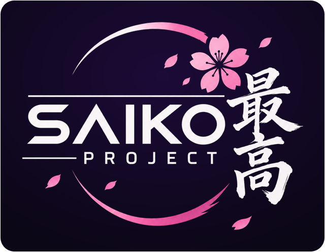

  

# medtrack

**A medication supply forecast that runs entirely on your device.**
Developed as part of the **Saiko Project**.

Tell medtrack what you take and how much you have, and it tells you when each medication runs out, plus the dates 5 and 4 weeks before, so you know when to reorder.

**Open it:** https://wontbedone.github.io/medtrack/

> **Made entirely with AI.** medtrack, including its code and logo, was created with AI. It was designed for personal use. It isn't medical advice: always check dates and amounts against your prescription, and ask your pharmacist or doctor if you're unsure.

---

## Use it like an app on your phone

**iPhone (Safari)**
1. Open the link above in Safari.
2. Tap the Share button, then **Add to Home Screen**.
3. Open medtrack from the blossom icon. It runs full screen and works offline.

**Android (Chrome)**
1. Open the link above in Chrome.
2. Tap the ⋮ menu, then **Add to Home screen** or **Install app**.

## How it works

medtrack looks like a terminal. Type a command and press Enter.

| Command | What it does |
|---|---|
| `begin` | start here: add your medications, or check the saved ones and enter today's amounts |
| `add` | add a medication |
| `setup` | enter schedules and amounts on hand |
| `show` / `show all` | short or full forecast |
| `list` | medications, amounts and schedules |
| `refill` | add a supply you just picked up |
| `copy` | copy run-out and reorder dates to paste into a calendar |
| `licence` | how medtrack may be used (`licence full` for the complete text) |
| `help` | every command |

When it asks how much you have, you can answer with the days too, like `8 mon thu` or `30 daily`.

## Your data

- **Saved:** medication names, units and doses, in your browser's local storage on this device. Type `saving off` to save nothing at all, or `forget` to delete what's saved.
- **Never saved:** schedules and amounts on hand. You enter them each time you open medtrack.
- **Never sent:** nothing you enter leaves your device. A security rule in the page blocks every connection except loading its own files.
- **Shared storage:** saved names belong to the web address, so other projects on the same `github.io` address can read them. Use `saving off` if that matters to you.

Type `about` in medtrack for the same details.

## Versions

Versions from 4.5.0 onwards are tagged releases in this repository. Earlier versions are no longer published. Type `changelog` in medtrack to see what changed in every version.

## Free to use, not for sale

medtrack is free for anyone to use, copy, change and share for any **non-commercial** purpose, under the [PolyForm Noncommercial License 1.0.0](LICENSE). That includes personal use, and use by charities, schools and other non-profit organisations.

It may not be sold, or used to make money, by anyone. Medtrack isn't sold by its creator either: it was made for personal use.

Version 4.4.0 was briefly released under the Unlicense. Every version from 4.5.0 onwards uses the non-commercial licence.

## Name and logo

The Saiko Project name and logo are not covered by the licence. They may not be used without permission, including on copies or changed versions of medtrack.
